<!-- Animated gradient banner -->

<h3>👋 Hello, I'm Dulanjana!</h3>

<!-- Animated typing headline -->

  
  
  

  
  

**Making ideas useful with code, curiosity, and AI.**

[About](#-about-me) · [Skills](#-tech-stack) · [Projects](#-featured-projects) · [Learning](#-currently-exploring) · [Connect](#-connect-with-me)

---

## 👨‍💻 About Me

I'm **Dulanjana Ayeshmantha**, a **BSc (Hons) Information Technology undergraduate** at **SLIIT**, specializing in **Artificial Intelligence**. I enjoy building practical software and exploring how intelligent systems can solve everyday problems.

- 🤖 **Passionate about:** Artificial intelligence, machine learning, and AI-powered applications.
- 💻 **I build:** Web applications, mobile applications, and full-stack software.
- 🧠 **Currently learning:** AI agents, large language models (LLMs), and better software engineering practices.
- 🎯 **My goal:** Turn challenging ideas into useful, well-designed products.
- 🤝 **Open to:** Learning together, developer connections, and collaborative projects.
- 📍 **Location:** Sri Lanka 🇱🇰

> **My approach:** Understand the problem → Build a solution → Test it → Keep improving.

<!-- Original animated SVG artwork: no external hosting needed -->

---

## 🛠️ Tech Stack

*Technologies I use in projects and continue to develop my skills in.*

### 💜 Programming Languages

  
  
  
  
  
  
  

### 💙 Web, Backend & Mobile

  
  
  
  
  
  
  
  

### 🩷 AI & Machine Learning

  
  
  
  
  
  

### 💚 Databases & Tools

  
  
  
  
  
  
  

---

## 🚀 Featured Projects

*A few of the projects I've built or worked on during my learning journey.*

<table>
<tr>
<td width="50%" valign="top">
  
  <h3>🧠 AI Travel Planning & Booking Management</h3>
  
<strong>University team project</strong>

  
Developing web and mobile workflows for AI-assisted travel planning, customer preferences, trip requests, and booking management. Exploring coordinated AI agents to support trip-planning decisions.

  
<code>React</code> <code>Flutter</code> <code>ASP.NET Core</code> <code>PostgreSQL</code> <code>Python</code> <code>LangGraph</code>

</td>
<td width="50%" valign="top">
  
  <h3>📈 Tourism Demand Forecasting</h3>
  
<strong>Kandy, Sri Lanka</strong>

  
Forecasting weekly tourism demand using weather and festival features, with what-if scenarios that can support planning decisions.

  
<code>LSTM</code> <code>Random Forest</code> <code>Forecasting</code>

</td>
</tr>
<tr>
<td width="50%" valign="top">
  
  <h3>🚗 Rent-a-Car</h3>
  
<strong>Mobile booking application</strong>

  
Vehicle bookings, owner listings, document submission, admin approval, authentication, and authorization.

  
<code>React Native</code> <code>Node.js</code> <code>Express.js</code> <code>MongoDB Atlas</code> <code>JWT</code> <code>Axios</code>

</td>
<td width="50%" valign="top">
  
  <h3>🅿️ Parking Management</h3>
  
<strong>Reservation and management system</strong>

  
Parking reservations and role-based workflows for customers, security, parking managers, finance, support, and administrators.

  
<code>Spring Boot</code> <code>SQL Server</code> <code>Design Patterns</code>

</td>
</tr>
<tr>
<td width="50%" valign="top">
  
  <h3>🏫 SchoolMS</h3>
  
<strong>Student management system</strong>

  
Student and academic administration with separate access for administrators, teachers, and students.

  
<code>Django</code> <code>Role-based Access</code>

</td>
<td width="50%" valign="top">
  
  <h3>🛒 E-Commerce</h3>
  
<strong>Full-stack application</strong>

  
Product management, user interactions, authentication, and database operations in an e-commerce system.

  
<code>Full-Stack</code> <code>Authentication</code> <code>Databases</code>

</td>
</tr>
</table>

  

---

## 🌱 Currently Exploring

| 🤖 Intelligent Systems | 🧩 Better Engineering | 🌍 Complete Products |
| :--- | :--- | :--- |
| AI agents, LLM applications, and machine learning foundations | Clean code, database design, testing, and Git collaboration | Connecting web/mobile interfaces with APIs and deploying applications |

---

<!-- Optional contribution snake: activate AFTER running the included .github/workflows/snake.yml
## 🐍 Contribution Snake

<picture>
  <source media="(prefers-color-scheme: dark)" srcset="https://raw.githubusercontent.com/IT24101200/IT24101200/output/github-snake-dark.svg" />
  <source media="(prefers-color-scheme: light)" srcset="https://raw.githubusercontent.com/IT24101200/IT24101200/output/github-snake.svg" />
  
</picture>

-->

## 🤝 Connect With Me

Interested in **AI, machine learning, software development, or building something useful together?**

I'm always happy to connect with other developers and learners.

  
  

### ✨ Learn. Build. Improve. Repeat.

*Thanks for visiting my profile!*

